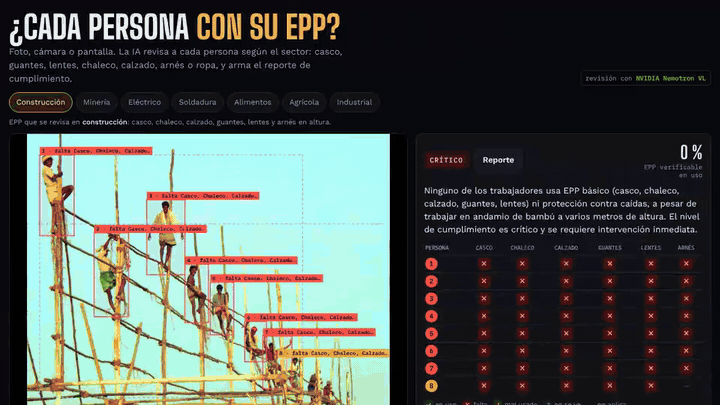
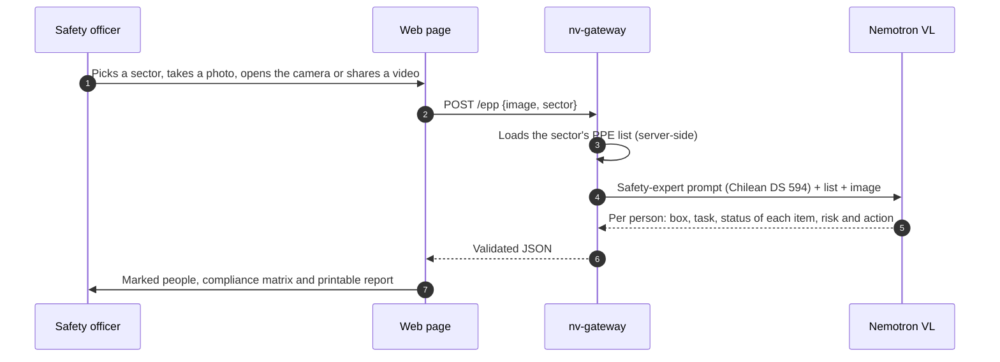
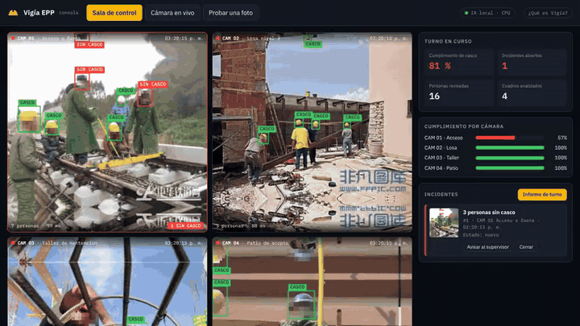

# Vigía PPE

**Is everyone wearing their PPE? Photo, camera or screen: NVIDIA AI checks each worker against the sector's requirements (hard hat, gloves, glasses, vest, boots, harness, clothing) and writes the compliance report. For continuous video on site, a custom detector runs locally, with no cloud.**

[Español](README.md) · **English**

> The interface is in Spanish.

## The problem

PPE checks are done by eye, person by person, on paper checklists. A classic detector sees hard hats, but not gloves, glasses, harnesses or whether clothing fits the task, and each sector requires something different.

## Two modes, two architectures

| | AI review (main page) | Real-time control room |
|---|---|---|
| Checks | All sector PPE, per person, plus their task | Hard hat |
| How | NVIDIA Nemotron VL, on demand or every 10 s | Custom YOLOv8 in the browser, several times per second |
| Source | Photo, phone/PC camera, or a shared tab playing a video | 4 site cameras or your own camera |
| Runs on | NVIDIA API via [nv-gateway](https://github.com/JSNN15/nv-gateway) | The site computer, no cloud |
| For | Audits, planned inspections, reports | Continuous watch and instant alerts |

## AI review

**PPE by sector**

| Sector | Checked |
|---|---|
| Construction | hard hat, vest, boots, gloves, glasses, harness at height |
| Mining | hard hat, vest, boots, glasses, gloves, hearing and respiratory protection by area |
| Electrical | dielectric hard hat, gloves, arc face shield, flame-resistant clothing, dielectric boots, harness on poles |
| Welding | welding mask, glasses, leather gloves, FR clothing, boots, hearing protection when grinding |
| Food | hairnet, mask, gloves, clean clothing, boots |
| Agriculture | gloves, respirator and glasses with agrochemicals, long sleeves, boots, sun protection |
| Industrial | hard hat, glasses, gloves, boots, vest, hearing protection with noise |

Each item comes back as **worn, missing, misused, not visible or not applicable**. "Not visible" stops the model from guessing; "not applicable" only applies to conditional items (a harness when not working at height). The compliance percentage counts only what can be verified.

**Camera and video.** The phone, tablet or PC camera opens in the same page. *Pantalla o video* shares a browser tab (for example a YouTube video of a job site) and the AI reviews the frame on screen, on demand or every 10 s. Works in desktop Chrome, Edge or Firefox.

## Real-time control room (local)

Custom YOLOv8 detector running in the site computer's browser (ONNX Runtime Web, WebGPU). On 200 unseen photos it caught 93 of 100 violations with 2 false alarms in 100 clean photos; the best NVIDIA vision model tested gave 25 ([full study](https://jsnn15.github.io/ia-epp/)). Faces are blurred before display or storage.

## Limits

- The AI only sees the image: it cannot confirm PPE certification, size or internal condition.
- Distant or occluded people end up mostly "not visible". That is intended: better than guessing.
- Boxes are approximate. The report supports the safety officer; it does not replace on-site inspection.

## Files

| File | What it is |
|---|---|
| `index.html` | AI review: sectors, photo, camera, screen, matrix and report. |
| `s/` | 12 sample photos with cached results. |
| `app.html`, `app.js`, `det.js` | Real-time control room and own-camera mode (local detector). |
| `model.onnx.part0`, `.part1` | Local detector weights. |
| `frames/`, `frames.json` | Control-room frames with blurred faces. |

## Licenses and credits

- Local detector trained with **Ultralytics YOLOv8 (AGPL-3.0)**, hence the AGPL-3.0 license.
- AI-review sample photos: Flickr and rawpixel via Openverse (CC BY 2.0 and CC0); authors listed in the page footer.
- Control-room frames: Hard Hat Workers (CC0), faces anonymized.

---

Personal project by **Julián Neira Nova**, electrical engineer with 10 years in mining operations · Servicio y Soluciones Tecnológicas DelaCruz SpA. Nothing here comes from clients or employers.
[Portfolio](https://jsnn15.github.io/) · [LinkedIn](https://www.linkedin.com/in/julian-neira-nova/) · [All tools](https://github.com/JSNN15)
