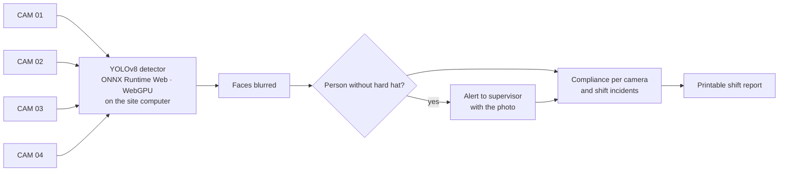

# Vigía PPE

**Watches site cameras, detects people working without a hard hat, alerts the supervisor with the photo and writes the shift report. The AI runs on site: images never leave the operation.**

[Español](README.md) · **English**

> The interface is in Spanish.

## The problem

A supervisor cannot watch four cameras for a whole shift. Violations are found when someone reviews the footage, after something already happened.

## How it works

## Results

Evaluated on **200 photos the model never saw** (100 with a violation, 100 without), the same set used to test NVIDIA vision models in [the PPE study](https://jsnn15.github.io/ia-epp/):

| | Violations detected | False alarms in 100 clean photos |
|---|---|---|
| **Vigía (custom YOLOv8, local)** | **93 of 100** | **2** |
| Best NVIDIA vision model tested (cloud) | 100 of 100 | 25 |

A general-purpose API model catches everything but floods the supervisor with false alerts. A task-specific detector running on site gives 12× fewer false alarms and sends no images to the internet.

## Privacy

Faces are blurred before any image is shown or stored. The detector runs in the site computer's browser: there is no server receiving video.

## Files

| File | What it is |
|---|---|
| `index.html` | Landing page. |
| `app.html`, `app.js` | Control room (`#sala`) and your-own-camera mode (`#vivo`). |
| `det.js` | Preprocessing, ONNX inference and non-max suppression. |
| `model.onnx.part0`, `.part1` | Detector weights split in two (GitHub file-size limit). |
| `frames/`, `frames.json` | Demo frames with blurred faces. |

## Licenses and credits

- Detector trained with **Ultralytics YOLOv8 (AGPL-3.0)**, so this repository is AGPL-3.0. Closed commercial use needs an Ultralytics license or a different detector.
- Demo photos: public **Hard Hat Workers** dataset (CC0), faces anonymized.
- Inference with ONNX Runtime Web (MIT).

---

Personal project by **Julián Neira Nova**, electrical engineer with 10 years in mining operations · Servicio y Soluciones Tecnológicas DelaCruz SpA. Nothing here comes from clients or employers.
[Portfolio](https://jsnn15.github.io/) · [LinkedIn](https://www.linkedin.com/in/julian-neira-nova/) · [All tools](https://github.com/JSNN15)
