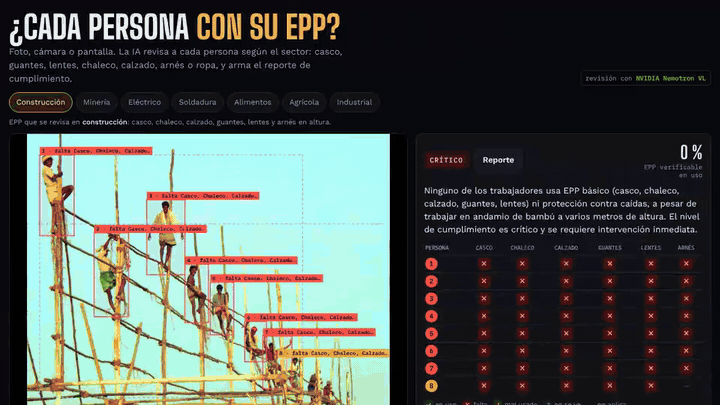
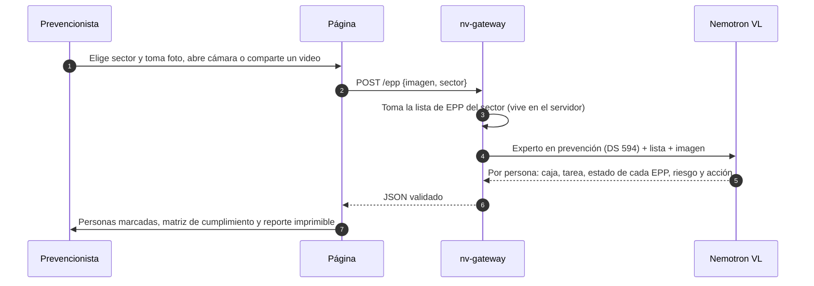
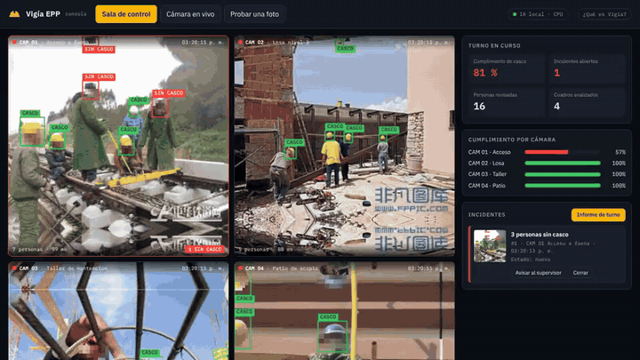

# Vigía EPP

**¿Cada persona con su EPP? Foto, cámara o pantalla: la IA de NVIDIA revisa a cada trabajador según el sector (casco, guantes, lentes, chaleco, calzado, arnés, ropa) y arma el reporte de cumplimiento. Para video continuo en faena, un detector propio corre en el equipo, sin nube.**

**Español** · [English](README.en.md)

## El problema

La revisión de EPP se hace a ojo, persona por persona, y queda en una lista de chequeo en papel. Un detector clásico ve cascos, pero no guantes, lentes, arnés ni si la ropa sirve para la tarea, y cada sector exige algo distinto.

## Dos modos, dos arquitecturas

| | Revisión con IA (página principal) | Sala de control en tiempo real |
|---|---|---|
| Qué revisa | Todo el EPP del sector, por persona, y la tarea que hace | Casco |
| Cómo | Nemotron VL de NVIDIA, a pedido o en ronda cada 10 s | Detector YOLOv8 propio en el navegador, varias veces por segundo |
| Fuente | Foto, cámara del celular o PC, o una pestaña compartida con un video | 4 cámaras de faena o la cámara propia |
| Dónde corre | API de NVIDIA a través de [nv-gateway](https://github.com/JSNN15/nv-gateway) | En el equipo de la faena, sin nube |
| Para qué | Auditorías, inspecciones planeadas, reportes | Vigilancia continua y aviso inmediato |

## Revisión con IA

**EPP por sector**

| Sector | Se revisa |
|---|---|
| Construcción | casco, chaleco, calzado, guantes, lentes, arnés en altura |
| Minería | casco, chaleco, calzado, lentes, guantes, auditiva, respirador según el área |
| Eléctrico | casco dieléctrico, guantes, careta contra arco, ropa ignífuga, calzado dieléctrico, arnés en poste |
| Soldadura | careta, lentes, guantes de cuero, ropa ignífuga, calzado, auditiva si esmerila |
| Alimentos | cofia, mascarilla, guantes, ropa limpia, botas |
| Agrícola | guantes, respirador y lentes con agroquímicos, manga larga, botas, protección solar |
| Industrial | casco, lentes, guantes, calzado, chaleco, auditiva si hay ruido |

Cada EPP vuelve como **en uso, falta, mal usado, no se ve o no aplica**. "No se ve" evita que el modelo adivine; "no aplica" solo vale para EPP condicionales (el arnés sin trabajo en altura). El porcentaje de cumplimiento cuenta solo lo verificable.

**Cámara y video.** La cámara del celular, tablet o PC se abre en la misma página. Con *Pantalla o video* se comparte una pestaña (por ejemplo un video de YouTube de una obra) y la IA revisa el cuadro que se está viendo, a pedido o cada 10 s. Funciona en Chrome, Edge o Firefox de escritorio.

## Sala de control en tiempo real (local)

Detector YOLOv8 propio que corre en el navegador del equipo de la faena (ONNX Runtime Web, WebGPU). En 200 fotos que nunca vio detectó 93 de 100 infracciones con 2 falsas alarmas en 100 fotos sin infracción; el mejor modelo de visión de NVIDIA probado dio 25 ([prueba completa](https://jsnn15.github.io/ia-epp/)). Las caras se pixelan antes de mostrar o guardar.

## Límites

- La IA ve lo que está en la imagen: no confirma certificación del EPP, talla ni estado interno.
- Con personas lejanas o tapadas, la mayoría de los EPP quedan como "no se ve". Eso es correcto: es mejor que inventar.
- Las cajas son aproximadas. El reporte es una ayuda para el prevencionista, no reemplaza la inspección en terreno.

## Archivos

| Archivo | Qué es |
|---|---|
| `index.html` | Revisión con IA: sectores, foto, cámara, pantalla, matriz y reporte. |
| `s/` | 12 fotos de ejemplo con su resultado guardado. |
| `app.html`, `app.js`, `det.js` | Sala de control en tiempo real y modo con cámara propia (detector local). |
| `model.onnx.part0`, `.part1` | Pesos del detector local. |
| `frames/`, `frames.json` | Cuadros de la sala de control, con rostros pixelados. |

## Licencias y créditos

- Detector local entrenado con **Ultralytics YOLOv8 (AGPL-3.0)**; por eso el repositorio es AGPL-3.0.
- Fotos de ejemplo de la revisión con IA: Flickr y rawpixel vía Openverse (CC BY 2.0 y CC0); autores en el pie de la página.
- Cuadros de la sala de control: Hard Hat Workers (CC0), rostros anonimizados.

---

Proyecto personal de **Julián Neira Nova**, ingeniero eléctrico con 10 años en faena · Servicio y Soluciones Tecnológicas DelaCruz SpA. Nada de lo publicado proviene de clientes ni de empleadores.
[Portafolio](https://jsnn15.github.io/) · [LinkedIn](https://www.linkedin.com/in/julian-neira-nova/) · [Todas las máquinas](https://github.com/JSNN15)
