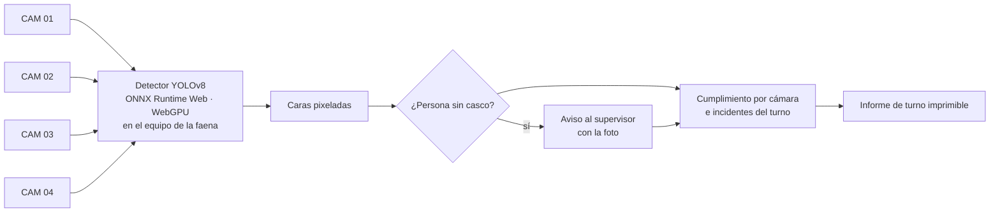

# Vigía EPP

**Mira las cámaras de la faena, detecta a quien trabaja sin casco, avisa al supervisor con la foto y escribe el informe de turno. La IA corre en el equipo: las imágenes no salen de la faena.**

**Español** · [English](README.en.md)

## El problema

Un supervisor no puede mirar cuatro cámaras durante todo el turno. Las infracciones se descubren al revisar la grabación, cuando ya pasó algo.

## Cómo funciona

## Resultados

Evaluado con **200 fotos que el modelo nunca vio** (100 con infracción y 100 sin), las mismas con las que se probaron los modelos de visión de NVIDIA en [la prueba de EPP](https://jsnn15.github.io/ia-epp/):

| | Infracciones detectadas | Falsas alarmas en 100 fotos sin infracción |
|---|---|---|
| **Vigía (YOLOv8 propio, local)** | **93 de 100** | **2** |
| Mejor modelo de visión de NVIDIA probado (nube) | 100 de 100 | 25 |

Un modelo general por API detecta todo pero satura al supervisor con avisos falsos. Un detector propio, entrenado para esta tarea y corriendo en el equipo, da 12 veces menos falsas alarmas y no envía imágenes a internet.

## Privacidad

Las caras se pixelan antes de mostrar o guardar cualquier imagen. El detector corre en el navegador del equipo de la faena: no hay servidor que reciba video.

## Archivos

| Archivo | Qué es |
|---|---|
| `index.html` | Presentación de la máquina. |
| `app.html`, `app.js` | Sala de control (`#sala`) y modo con la cámara propia (`#vivo`). |
| `det.js` | Preprocesamiento, inferencia ONNX y supresión de no máximos. |
| `model.onnx.part0`, `.part1` | Pesos del detector en dos partes (límite de tamaño de GitHub). |
| `frames/`, `frames.json` | Cuadros de demostración con rostros pixelados. |

## Licencias y créditos

- Detector entrenado con **Ultralytics YOLOv8 (AGPL-3.0)**; por eso este repositorio es AGPL-3.0. Un uso comercial cerrado requiere licencia de Ultralytics o cambiar de detector.
- Fotos de demostración: conjunto público **Hard Hat Workers (CC0)**, con rostros anonimizados.
- Inferencia con ONNX Runtime Web (MIT).

---

Proyecto personal de **Julián Neira Nova**, ingeniero eléctrico con 10 años en faena · Servicio y Soluciones Tecnológicas DelaCruz SpA. Nada de lo publicado proviene de clientes ni de empleadores.
[Portafolio](https://jsnn15.github.io/) · [LinkedIn](https://www.linkedin.com/in/julian-neira-nova/) · [Todas las máquinas](https://github.com/JSNN15)
